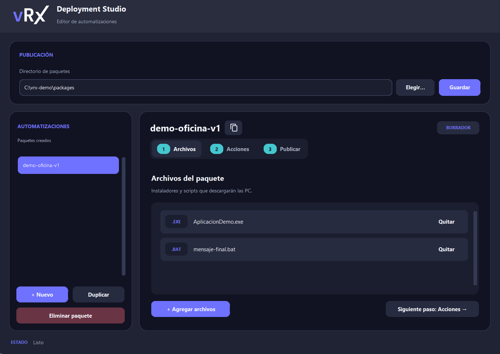
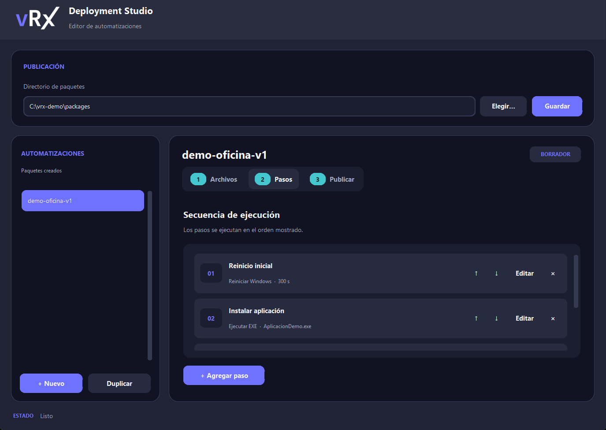
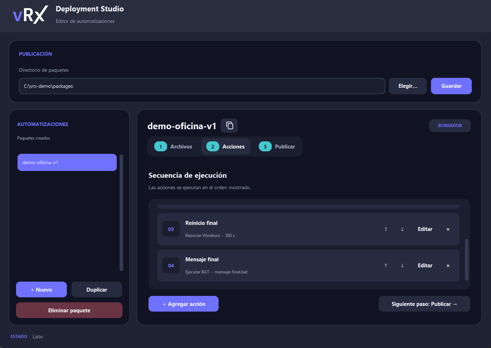
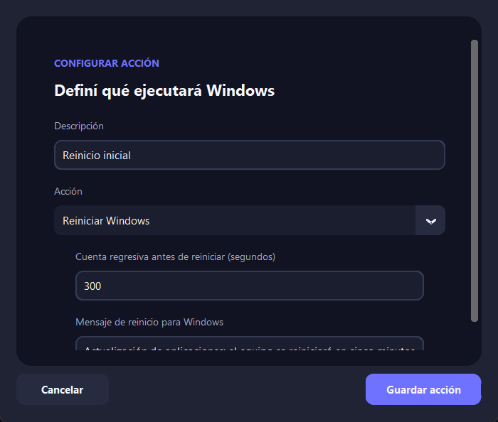
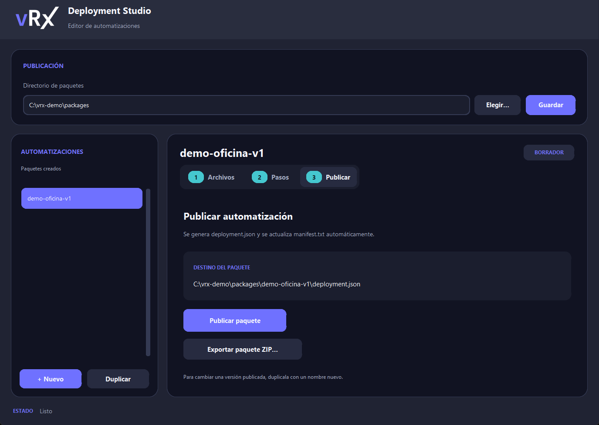

# vRx Custom Deploy

Aplicación de escritorio para **Ubuntu con entorno gráfico** que permite crear paquetes de despliegue sin escribir `deployment.json` a mano. El operador carga archivos, ordena pasos y pulsa **Publicar paquete**. Las PC Windows reciben el paquete a través de una única acción de vRx.

> **Estado del piloto:** el editor y la publicación tienen pruebas automáticas. La ejecución con tareas programadas, reinicios y descargas reanudables aún debe validarse en las PC Windows del piloto. El repositorio HTTP actual no autentica el origen de los paquetes.

## Cómo funciona

```text
Ubuntu: dashboard → /srv/packages/<paquete>/ → Nginx
                                             ↓ descarga
vRx: acción fija → bootstrap en Windows → tarea local persistente
                                             ↓
                              descarga, verificación y pasos
```

El dashboard guarda los borradores en `~/.vrx-deployment/drafts/`. Al publicar, copia los archivos a `/srv/packages/<nombre>/`, genera allí `deployment.json` y actualiza `/srv/packages/manifest.txt`. El botón **Guardar** del directorio de paquetes conserva esa ruta en `~/.vrx-deployment/settings.json`; no configura una IP. La IP del Ubuntu se escribe en la acción fija de vRx.

En Windows, el bootstrap puede lanzarse en modo `DownloadOnly` para descargar en distintos horarios. Luego se vuelve a lanzar la **misma acción** en modo `Deploy`. Una tarea local sigue trabajando aunque la ejecución de vRx ya haya terminado; al recuperar conexión o encenderse la PC, reintenta las descargas pendientes. También se puede lanzar directamente en modo `Deploy`.

Las tareas programadas `vRxDeploy-Launch` y `vRxDeploy-Resume` se eliminan cuando el despliegue termina o falla de forma definitiva. Mientras la descarga siga pendiente, o el paquete esté en `Staged` esperando el lanzamiento `Deploy`, la tarea de descarga permanece registrada para poder continuar.

## Instalar el dashboard en Ubuntu

Estos comandos se ejecutan en el **Ubuntu con escritorio gráfico** donde está el repositorio. Si ya lo clonaste, entrá directamente en su carpeta y omití `git clone`.

```bash
sudo apt update
sudo apt install -y git python3 python3-tk python3-venv
git clone https://github.com/nmbenitez/vrx-custom-deploy.git
cd vrx-custom-deploy
python3 -m venv .venv
.venv/bin/python -m pip install -r dashboard/requirements.txt
```

El directorio de publicación predeterminado es `/srv/packages`. Si este Ubuntu **ya sirve paquetes con Nginx** y tu usuario puede escribir allí, conservá esa configuración. Para preparar un servidor nuevo con los scripts del proyecto:

```bash
bash ubuntu-server/01-install-nginx.sh
bash ubuntu-server/05-create-package-repository.sh
bash ubuntu-server/02-configure-nginx.sh
```

El último script configura Nginx para servir `/srv/packages` en `http://IP-DEL-UBUNTU/packages/` y sustituye el sitio predeterminado de Nginx. Ejecutá `05-create-package-repository.sh` desde tu usuario de escritorio; el script usa `sudo` internamente para asignarle permisos sobre `/srv/packages`. Squid es opcional para tráfico a Internet y no hace falta para abrir el dashboard.

Abrí la aplicación:

```bash
.venv/bin/python -m dashboard.desktop
```

En **Directorio de paquetes**, verificá que diga `/srv/packages` y pulsá **Guardar**. Si querés abrirla desde el menú de Ubuntu, instalá el acceso directo una vez:

```bash
.venv/bin/python -m dashboard.install_launcher
```

El acceso directo usa esta carpeta y su `.venv`; si movés el proyecto, volvé a instalarlo. Para actualizar una instalación ya clonada, cerrá la aplicación, ejecutá `git pull` dentro del repositorio y volvé a abrirla.

## Crear y publicar un paquete

Las capturas muestran un **ejemplo ficticio** tomado en Windows. El programa es el mismo en Ubuntu; allí la ruta superior será `/srv/packages`.

### 1. Crear el borrador y cargar archivos

Pulsá **+ Nuevo** e ingresá un nombre único, por ejemplo `demo-oficina-v1`. Ese nombre será el directorio publicado y el valor de `$RemoteFolder` en vRx. Después, en **Archivos**, pulsá **+ Agregar archivos** y elegí los instaladores o scripts que ejecutarán las PC. Para el ejemplo se cargaron un `.exe` y un `.bat`.



### 2. Agregar los pasos en orden

Entrá en **Pasos** y pulsá **+ Agregar paso** por cada acción. Primero debe existir un paquete creado con **+ Nuevo**. La descripción identifica el paso en la lista; el orden se cambia con las flechas.

| Orden | Descripción de ejemplo | Acción | Archivo | Argumentos | Códigos de éxito |
| --- | --- | --- | --- | --- | --- |
| 1 | Reinicio inicial | Reiniciar Windows | No requiere | No requiere | No requiere |
| 2 | Instalar aplicación | Ejecutar EXE | `AplicacionDemo.exe` | `/S` | `0,3010` |
| 3 | Reinicio final | Reiniciar Windows | No requiere | No requiere | No requiere |
| 4 | Mensaje final | Ejecutar BAT | `mensaje-final.bat` | Vacío | `0` |

Los argumentos dependen del instalador real; `/S` aquí es solo un ejemplo. El código `3010` significa que el instalador solicita un reinicio. Si el siguiente paso ya es **Reiniciar Windows**, ese paso realiza el reinicio con su aviso configurado.

También podés elegir **Mostrar mensaje** para sumar un aviso emergente como paso independiente, por ejemplo antes de instalar o al finalizar. No requiere archivo: configurás el texto y los segundos que quedará visible. El despliegue continúa sin esperar que el usuario cierre el aviso; si no hay una sesión activa, ese paso falla.





Para un reinicio con aviso, elegí **Reiniciar Windows**, escribí la **cuenta regresiva en segundos** y el **mensaje de reinicio para Windows**. Por ejemplo, `300` significa cinco minutos. Se pueden configurar mensajes distintos para el reinicio inicial y el final. Con `0` y el mensaje vacío, el reinicio es inmediato. El aviso usa el mecanismo de Windows equivalente a `shutdown /r /t 300 /f /c "mensaje"`; al terminar la cuenta regresiva, Windows fuerza el cierre de aplicaciones, con posible pérdida de datos no guardados ([documentación de Microsoft](https://learn.microsoft.com/en-us/windows-server/administration/windows-commands/shutdown/)).



El aviso de reinicio lo muestra Windows. Un `.bat` ejecutado por el motor como `SYSTEM` no garantiza que su ventana o mensaje final sea visible para el usuario conectado.

### 3. Publicar

Entrá en **Publicar** y comprobá el destino. Pulsá **Publicar paquete**. En Ubuntu, el ejemplo quedaría en:

```text
/srv/packages/demo-oficina-v1/
├── AplicacionDemo.exe
├── mensaje-final.bat
└── deployment.json

/srv/packages/manifest.txt
```



El paquete publicado queda fijo. Para cambiar archivos o pasos, pulsá **Duplicar**, asigná un nombre nuevo (por ejemplo `demo-oficina-v2`) y publicá esa versión. **Exportar paquete ZIP** crea una copia portátil, pero no la publica automáticamente en `/srv/packages`.

Para comprobar que Nginx sirve el JSON después de publicar:

```bash
curl -f http://127.0.0.1/packages/demo-oficina-v1/deployment.json
```

## Lanzar desde vRx

En vRx se carga **una sola acción** con [`windows-client/09-vrx-bootstrap.ps1`](windows-client/09-vrx-bootstrap.ps1). No se genera un bootstrap por paquete. Antes de cada lanzamiento se editan las variables al comienzo de ese mismo script:

```powershell
$Server = "192.0.2.10"                   # IP o nombre del Ubuntu; normalmente se fija una vez
$RemoteFolder = "demo-oficina-v1"        # Nombre exacto del paquete publicado
$BootstrapMode = "DownloadOnly"         # Primera fase: solo descargar y verificar
$DownloadRoot = "C:\Infrastructure\Packages" # Carpeta local en cada PC Windows
```

Estas son las variables que puede cambiar el operador. Los archivos del paquete se guardan en `$DownloadRoot\<nombre-del-paquete>`, por ejemplo `C:\Infrastructure\Packages\demo-oficina-v1`. Usá la misma ruta en las fases `DownloadOnly` y `Deploy`; el bootstrap rechaza una ruta distinta para un paquete ya preparado. El método de descarga, el uso de proxy y los reintentos ya tienen valores internos predeterminados.

Lanzá `DownloadOnly` para los grupos y horarios elegidos. Cuando toque instalar, cambiá solo `$BootstrapMode` a `"Deploy"` y ejecutá de nuevo la misma acción. Si elegís `Deploy` desde el principio, descarga lo que falte y luego instala. El bootstrap devuelve el control a vRx enseguida; la tarea local continúa por su cuenta.

Si ya habías cargado una versión anterior del bootstrap en vRx, reemplazá el contenido de esa acción por la versión actual para habilitar el paso **Mostrar mensaje**. Esto se hace al actualizar el sistema, **no cada vez que creás un paquete**. Si vRx programa ejecuciones futuras de una misma acción, comprobá si conserva las variables al programarlas o lee su valor al ejecutarlas antes de cambiar `DownloadOnly` a `Deploy`.

## Archivos y verificaciones

| Ruta | Función |
| --- | --- |
| `dashboard/` | Editor de escritorio, validación y publicación. |
| `ubuntu-server/` | Preparación de Nginx, repositorio y proxy opcional. |
| `windows-client/09-vrx-bootstrap.ps1` | Script único que se carga en vRx. |
| `windows-client/11-deployment-launch-worker.ps1` | Descarga recuperable y preparación del paquete. |
| `windows-client/06-deployment-engine.ps1` | Ejecución y continuación entre reinicios. |
| `tests/capture_readme.py` | Regenera estas capturas con datos ficticios en un equipo con escritorio. |

Para verificar cambios de código en un entorno de desarrollo:

```bash
python3 tests/test-package.py
python3 -m unittest discover -s tests -p test_dashboard.py
```

Las comprobaciones Bash de `test-package.py` se omiten cuando Bash no está disponible. El [plan de pruebas del piloto](documentation/PLAN_PRUEBAS_V03.md) cubre la validación pendiente en Windows.

## Límites actuales

- La tarea local y la continuación tras reinicios necesitan pruebas en Windows antes de usarse con los equipos del cliente.
- `Completed` confirma que terminaron los pasos configurados; todavía no detecta si el producto quedó instalado.
- Si una PC se apaga durante un instalador, hace falta evaluar ese instalador antes de repetir el paso.
- Los hashes SHA-256 detectan daños en archivos, pero el HTTP del piloto no autentica su origen. Los scripts se ejecutan como `SYSTEM`.
- El editor no consulta todavía estados por equipo mediante la API de vRx.

Esta edición pública usa datos y capturas ficticios; no contiene archivos ni configuraciones del cliente.
